# Nexus: the restart

On 4 October 2026 the application that lived here was deleted down to its kernel and its data, on purpose and with
no sunk cost counted (the reasoning, measured, is in [docs/NEXUS-RESTART.md](docs/NEXUS-RESTART.md); the mid-restart
alignment check against the code as written, with what is solid, at risk and missing, is
[docs/NEXUS-ALIGNMENT-1.md](docs/NEXUS-ALIGNMENT-1.md)). The last commit
of the whole application is `792c328`: a VR creative sandbox for the Quest 3S with an in-app engineer, a knowledge
tree, a construction grammar, creatures and places. Everything it learned survives here as documents, data and tests;
nothing of its architecture is extended again.

## What is here now

- `src/physics`, `src/engineering`, `src/connectors`, `src/parts`, `src/doc`, `src/schema`, `src/persistence`,
  `src/construct/build.ts`: the rigid-body kernel (Jolt), its numerics, its joint capacities, its document of bodies and
  the gate that admits bodies into it. This is a **realization backend** with measured error: its conformance tests
  (`tests/conformance`, `tests/golden`) are against exact results and are kept green.
- `src/data`, `src/ganglia/laws.ts`, `src/ganglia/units.ts`: materials with sources, the person's measures with
  sources, 144 laws with inputs, outputs, validity and sources, and the dimension algebra. **Data**, to be re-expressed
  as terms; not the executable form.
- `docs`: every audit, autopsy, design and observation, including the failures that showed the way.
- `src/nexus`: the new core, built in the order of docs/NEXUS-RESTART.md Part XXIV, on five primitives: quantity,
  term, mode, origin, identity. `dimension` (the algebra, Buckingham groups), `status` (the lattice, no default),
  `identity` (content hashes), `term` (leaves with origin classes, operators with identity, canonical form, and the
  binder: ∫ body d(coordinate) between two ends, the one way a term says "over"; the bound coordinate is not free,
  the rule's resolution is a leaf in the term so the method is in the identity and the closure, the discretization
  error is measured by halving it; with it the pendulum's period factor is generated from energy conservation as
  the elliptic integral instead of written as a series, the series becomes its expansion with a measured truncation,
  and the prism's mass, section moments and inertia are one mechanism, integrals of the shape),
  `evaluate` (every evaluation a derivation record; unknown stays unknown; validity refused with the domain named),
  `law` and `book` (every one of the kept 144 laws as a term, SI inside and unit conventions at the ports, with its
  validity as predicate terms, every constant a sourced leaf, and the kept worked example reproduced; plus the
  slice's derived laws),
  `solve` (propagation, free variables reported, contradictions kept, search over declared options under a declared
  preference), `space` (a system's configuration space: every bound variable a field over the free variables by
  symbolic propagation, the region the constraints, the applied laws' validity domains and the learned language
  over the couplings' quantities; a catalogue is an availability set inside it and selecting within it reproduces
  the search; a derivation visits a lattice and refines around the least admissible address, keeping every address
  visited), `explore` (a derivation at the edge of the language is an experiment: realized, observed, and when the
  kernel contradicts the language the observation joins the evidence, the distinction is abduced again, the old
  relation is superseded and the space is derived again: the beam's first derived section rocked, the language grew
  to hcm · halfX / halfZ² over nine observations, and the next section rested with less material than the
  catalogue's pick), `field` (declared frame, sourced gravity, ground as a field query, the observer's window and the rigid
  domain), `domain` (regions of x, y, z, t in a frame with the scale bands their description holds in; fields as
  laws composed over coordinates, sampled as records that cite the laws; the observer's resolution, with the window
  as the coarse-graining operator: a sample is the field's mean over the support cell, uncertain by its range
  across it, refused outside a scale band with the band named; coverage of a lattice of point samples is zero), `coupling` (rest and stand couplings: every coordinate a solution; the ledger), `realize` (the kernel as a
  morphism under a contract whose numbers are its own conformance measurements), `elastic` (a second realization:
  the elastic line integrated on a grid, for a span on two supports and for a cantilever from a fixed root,
  independent of the closed-form laws, every observable's error measured by halving the cell, stationary in time;
  it observes the sag the rigid kernel cannot, and it caught the bracket's tip-sag law treating a patch as a point), `observe` (comparison within the
  contract, unobserved as its own status, the append-only journal), `why` (WHY total, IMPACT, staleness),
  `failure` (the four representational failures as terms: anomaly, contradiction, a variable free that the intent
  did not leave free, a measurement no variable can hold), `abduce` (the missing distinction searched for over the
  dimensionless groups of the failing coupling's quantity types, found from their dimensions alone; a candidate that
  separates every observation, validated on held-out observations where it predicts and silent where it does not,
  promoted with provenance "abduced from observations h1…hn" (each an observation's own identity: its system, its
  coupling, its quantities' records, the observed and the derived) only when it changes more than one system; a tie names
  the quantities the next observation must vary; a judgement inside the bound's uncertainty is unresolved, not
  decided), `study` (the same intent realized with one coupling's quantities varied, every run a system in the
  journal), `project` (a scene is a pure function of bound records: a box for every placed body and nothing else,
  every number naming its record; a renderer consumes it and decides nothing), `beam`: the vertical slice of
  Part XXV, `swing`: the third slice, where time is the coordinate (a bar on a free hinge released from an angle:
  the period derived from the prism's inertia and the amplitude series, the angle a field over t whose scale band
  is the sampling law, the kernel's samples a lattice at its tick with the tick as their support, the period read
  from the zero crossings with the tick as its resolution, the swing energy the hinge coupling's ledger over time,
  and the kernel's dissipation and period error its contract, fixed by a new conformance test), and `bracket`: the
  second slice, an arm bolted to a post, where a joint is a coupling whose shared
  boundary variables (the root moment and shear) are read from the solution, bounded by the bolt group's capacity
  at the declared factor, and measured by the kernel under a contract its own conformance test fixes at 1 %; the
  catalogue of sections and bolt groups is searched under two preferences in order (least section, then least bolt
  steel), and a 0.6 m arm was refused honestly because a 38 mm section is not slender enough for the sag law's
  domain. A 60 kg mass across 1.2 m: the solver reports the section free, the
  catalogue under least material picks a 2×4 laid flat (the on-edge sections refused by the lateral-stability
  domain, the 4×4 by slenderness, the 2×2 by sag), every coordinate is derived from the declared frame, the kernel
  measures the bending moment at four seams, each the mean over its quiet time with the range as uncertainty, within
  1 % of the moment field resolved at those points under a quasi-static scale band, and the sag is unobserved
  by the rigid realization, which says it cannot see it, and observed by the elastic one within the error it
  measured on itself, which also confirms the derived patch-load laws independently. The environment test of Part XX runs: the same intent on a flat
  field, a slope and a field with a hole; the ground is a field over x and z, the supports are posts cut to their own
  ground, the design is identical by hash on all three, and every record that differs between the fields rests on the
  ground field or on a kernel measurement. The second growth came from the joint: the derivation bounds a bolted joint by the group's bending capacity
  only, the kernel also breaks one in shear; ten brackets with the load and the bolt group varied, the arm section
  fixed as the experiment's configuration, gave two anomalies among the nine the language predicted to hold (the
  residual rule: what it already predicts to fail is explained and does not enter the abduction); over the joint's
  quantities (root moment, root shear, bolt diameter, bolts, their strength, the lever) the unique simplest group
  separating the two from the seven is the shear over the bolts' section strength, with its bound bracketing the
  kernel's own capacity; without the small-post observation it ties with a lever group and the next observation is
  named. The third growth came from time: the derivation conserves the swing energy and the kernel's contract allows
  its own dissipation over the watch; nine bars on a pin with the hinge's friction torque, the release angle and the
  pin's place varied gave four anomalies; over the hinge's quantities (the friction torque, the swing energy, the
  release angle, the mass, gravity, the pivot distance) the unique simplest separating group is the friction's work
  over a swing against the swing energy, τ θ₀ / E₀, Coulomb's, its bound bracketing the contract's two per cent a
  period (4 τ θ₀ a period is 0.005 of E₀ at that allowance); the torque over the weight's lever alone, τ / (m g d),
  does not separate, and the group through the small-angle identity, τ / (m g d θ₀), separates with half the bound.
  The first growth of the language came from the
  kernel: a tall load that the static derivation said rests never settled; eight realizations of the same intent
  with the load's footprint varied gave the observations; over the rest coupling's quantities (centre of mass above
  the base, half the contact along and across, gravity, the observer's patience, the mass) the one simplest group
  that separates rest from rocking or toppling is the centre of mass over half the contact across the beam, with the
  bound between 4.3 and 5.7 fixed by the observations; the language now refuses the column, admits the slab and
  says it cannot decide a case inside the gap. Among what did not rest in place, the drop separates rocking from
  falling by the same group further out, a second relation: a column that rocks is refused by the first and admitted
  by the second, a slab on edge by neither.

## The gate

```bash
npm ci
npm run gate      # typecheck, then every test: kernel conformance, golden, codec, and the architecture tests
```

Promoted relations enter construction: before anything is realized, a slice judges every coupling by the language
and refuses with the relation named, or says it cannot decide a case inside a bound's uncertainty; every judgement
cites the language's hash, so a promotion makes exactly the judgements stale, and regenerating them under the grown
language changes them and nothing else.

The architecture tests (`tests/nexus`) are the gate that matters: a bare value is unconstructable, an unknown never
becomes a default, WHY is total, every coordinate is a solution, every runtime effect is a derivation record, and a
change to a law reaches exactly what rests on it.

## What must not be built yet

A dog, a motor, a table, a beach; a category, a family, a role, a kind; a construction library, a template, a default;
a natural-language front end; the headset and the tablet; a renderer that is anything but a projection of bound terms;
a second realization before the first has a measured contract. See docs/NEXUS-RESTART.md Part XXII for the full list
of red flags.

## Pictures from words

<!-- image-leads: written by `npm run image:examples` from EXAMPLES in tools/image-examples.mjs -->
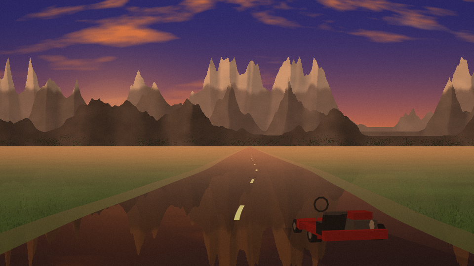

*`a red go-kart on a wet road at dusk, mountains behind`* (seed 7) — The header's first example. The kart is 1.85 m
long (the rental-kart row in vehicles.mjs) on a 3.5 m lane, seen from behind and a little to the side as it goes away
down the road; the wet asphalt mirrors the dusk sky and the mountains fade into the air. In the JSON below, `things`
carries the count painted ("mountains" named none, so the usual three) and the instance says `usual: true`.

<details><summary><code>--describe</code>: what the words were read as</summary>

```json
{
  "prompt": "a red go-kart on a wet road at dusk, mountains behind",
  "recognised": 5,
  "time": "sunset",
  "hour": 18.5,
  "clouds": 0.35,
  "fog": 0,
  "rain": 0,
  "snow": 0,
  "storm": false,
  "wet": true,
  "season": null,
  "moonPhase": null,
  "ground": "grass",
  "land": "grass",
  "road": true,
  "roadKind": "asphalt",
  "beach": false,
  "river": false,
  "frozen": false,
  "waterWord": null,
  "lake": false,
  "things": {
    "karts": 1,
    "mountains": 3
  },
  "colours": {
    "karts": "red"
  },
  "instances": [
    {
      "kind": "karts",
      "count": 1,
      "size": 1,
      "modifiers": [],
      "word": "go-kart",
      "index": 2,
      "colour": "red"
    },
    {
      "kind": "mountains",
      "count": 3,
      "size": 1,
      "modifiers": [],
      "word": "mountains",
      "index": 9,
      "usual": true
    }
  ],
  "ignored": [],
  "overridden": [],
  "report": {
    "visible": {
      "karts": [
        1,
        1
      ]
    }
  }
}
```

</details>

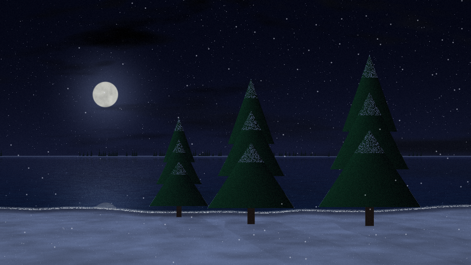

*`three pine trees by a lake under a full moon, snow`* (seed 3) — Three pines counted and placed apart on the near
shore, snow on every top edge, the full moon with its glow laid on the lake and a far bank of small trees beyond it;
"moon" turned the time to night and the tool said so (overridden, below).

<details><summary><code>--describe</code>: what the words were read as</summary>

```json
{
  "prompt": "three pine trees by a lake under a full moon, snow",
  "recognised": 4,
  "time": "night",
  "hour": 23,
  "clouds": 0.35,
  "fog": 0,
  "rain": 0,
  "snow": 0.7,
  "storm": false,
  "wet": false,
  "season": null,
  "moonPhase": "full",
  "ground": "water",
  "land": "snow",
  "road": false,
  "roadKind": null,
  "beach": true,
  "river": false,
  "frozen": false,
  "waterWord": "lake",
  "lake": true,
  "things": {
    "trees": 3,
    "moon": 1
  },
  "colours": {},
  "instances": [
    {
      "kind": "trees",
      "count": 3,
      "size": 1,
      "modifiers": [],
      "word": "pine trees",
      "index": 1
    },
    {
      "kind": "moon",
      "count": 1,
      "size": 1,
      "modifiers": [
        "full"
      ],
      "word": "moon",
      "index": 9
    }
  ],
  "ignored": [],
  "overridden": [
    {
      "what": "time",
      "from": "day",
      "to": "night",
      "because": "moon"
    }
  ],
  "report": {
    "visible": {
      "trees": [
        3,
        3
      ]
    }
  }
}
```

</details>
<!-- /image-leads -->

`tools/image.mjs` is a tool beside Nexus, not part of it: a line of words becomes a picture here, with no model, no
service and no key. The words are read into a scene (the time of day, the weather, the ground, what stands on it and
how many), the scene is painted pixel by pixel through a camera in metres, and the pixels are written as a PNG by the
file's own encoder: one command, Node 18+, nothing to install, zero dependencies. The tool is `tools/image.mjs` (the
shell and the PNG writer) plus the `tools/image/` folder (the painter, about twenty files); run it from the repo root.
The same words give the same bytes every time (`--seed` asks for another picture of the same reading), and what the
tool did not understand it says: every ignored word and every silent change go to stderr, into `--describe`, and
into the PNG itself as a tEXt chunk, so any picture can be traced to its words.

What no preset tool gives you, in one list:

- `--describe` prints the reading as JSON (the things with their counts, colours and sizes, the conditions, every
  ignored word, every silent change) and paints nothing; the same JSON is folded under the four pictures below.
- After every picture stderr says what was read, what was not understood, what was changed and what the critic could
  see once painted (`visible: trees 3/3, houses 1/2`); `--strict` writes nothing and exits 3 when a word that looks
  like a noun was not understood.
- The same words give the same bytes, on any machine; `--seed` is the only other source of change.
- Every PNG carries its reading in a `Comment` tEXt chunk beside a `Software` chunk, so a picture can be traced
  to its words with a hex dump.
- `npm run image:examples -- --check` repaints every picture in this section and fails on a byte of drift, so nothing
  here is retouched or stale. A 960x540 picture takes about 0.6 s here (the tested budget is 640x360 under 0.4 s);
  1080p about 2 s, 4K about 7 s.

```bash
node tools/image.mjs "three pine trees by a lake under a full moon, snow" --out lake.png --size 960x540
node tools/image.mjs "a city skyline at night in the rain" --describe      # the reading as JSON, no picture
node tools/image.mjs "two sailboats at sunset" --strip 6 --size 480x270     # six seeds in one wide picture
```

<!-- image-examples: written by `npm run image:examples` from EXAMPLES in tools/image-examples.mjs -->
<table><tr>
<td width="50%">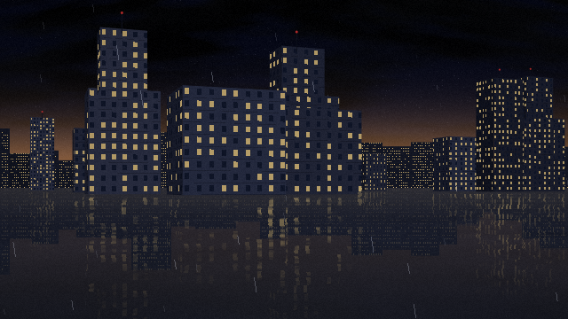</td>
<td width="50%">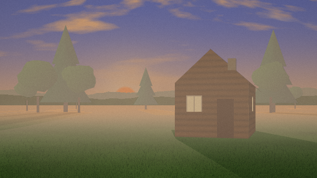</td>
</tr><tr><td valign="top">

*`a city skyline at night in the rain`* (seed 5) — The header's third example: a skyline row at the horizon with lit
windows, nearer towers, rain in three depths, wet pavement.

<details><summary><code>--describe</code>: what the words were read as</summary>

```json
{
  "prompt": "a city skyline at night in the rain",
  "recognised": 4,
  "time": "night",
  "hour": 23,
  "clouds": 0.8,
  "fog": 0,
  "rain": 0.6,
  "snow": 0,
  "storm": false,
  "wet": true,
  "season": null,
  "moonPhase": null,
  "ground": "pavement",
  "land": "pavement",
  "road": false,
  "roadKind": null,
  "beach": false,
  "river": false,
  "frozen": false,
  "waterWord": null,
  "lake": false,
  "things": {
    "buildings": 11
  },
  "colours": {},
  "instances": [
    {
      "kind": "buildings",
      "count": 11,
      "size": 1,
      "modifiers": [],
      "word": "city skyline",
      "index": 1,
      "usual": true
    }
  ],
  "ignored": [],
  "overridden": [],
  "report": {
    "visible": {
      "buildings": [
        8,
        11
      ]
    }
  }
}
```

</details>

</td><td valign="top">

*`a cabin in a foggy forest at dawn`* (seed 2) — The header's fourth example. Fog thickens with depth: the far trees
go first, the ranges behind them are a band in the air, and the cabin stands clear on the near grass with its shadow
thrown by the low sun.

<details><summary><code>--describe</code>: what the words were read as</summary>

```json
{
  "prompt": "a cabin in a foggy forest at dawn",
  "recognised": 4,
  "time": "dawn",
  "hour": 6,
  "clouds": 0.35,
  "fog": 0.6,
  "rain": 0,
  "snow": 0,
  "storm": false,
  "wet": false,
  "season": null,
  "moonPhase": null,
  "ground": "grass",
  "land": "grass",
  "road": false,
  "roadKind": null,
  "beach": false,
  "river": false,
  "frozen": false,
  "waterWord": null,
  "lake": false,
  "things": {
    "houses": 1,
    "trees": 9,
    "hills": 2
  },
  "colours": {},
  "instances": [
    {
      "kind": "houses",
      "count": 1,
      "size": 1,
      "modifiers": [],
      "word": "cabin",
      "index": 1
    },
    {
      "kind": "trees",
      "count": 9,
      "size": 1,
      "modifiers": [],
      "word": "forest",
      "index": 5,
      "usual": true
    }
  ],
  "ignored": [],
  "overridden": [
    {
      "what": "hills",
      "from": "none",
      "to": "the usual",
      "because": "nothing else breaks the horizon"
    }
  ],
  "report": {
    "visible": {
      "houses": [
        1,
        1
      ],
      "trees": [
        8,
        9
      ]
    }
  }
}
```

</details>

</td></tr></table>

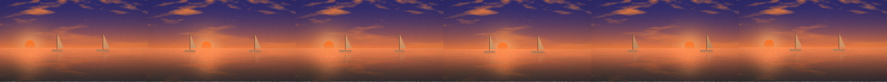

*`two sailboats at sunset`* (seed 1) — One prompt, six seeds side by side (`--strip 6`): the boats and the sun move;
the clouds are the same field, and the reading is the same. Each cell can be had alone with `--seed`.

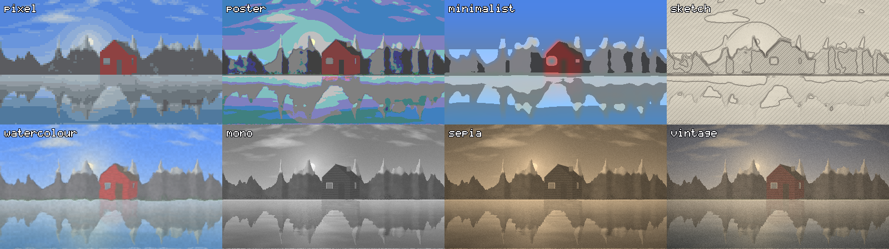

*`a mountain lake with a red cabin`* (seed 4) — The eight finishes over one picture (`--style`, or the word in the
prompt): pixel, poster, minimalist, sketch, watercolour, mono, sepia, vintage. The labels are the tool's own 5x7 font.

<table><tr>
<td width="50%">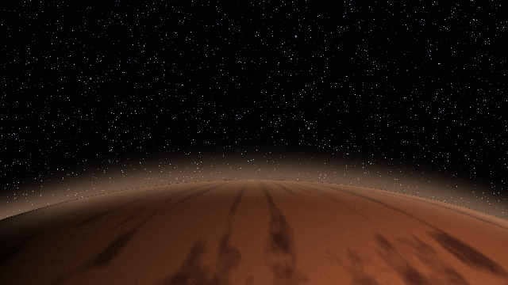</td>
<td width="50%">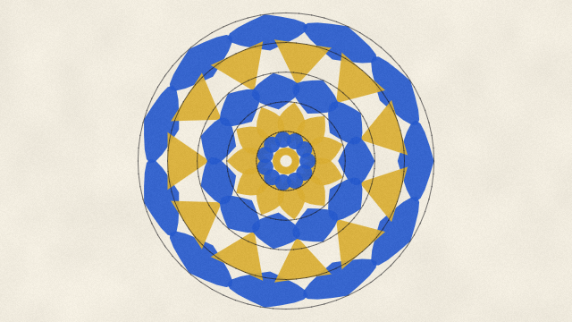</td>
</tr><tr><td valign="top">

*`mars from orbit`* (seed 11) — The space family: a sphere shaded from the light's side, in Mars's known colours (not
a photograph), the limb across the bottom third because "orbit" puts the eye low over it.

</td><td valign="top">

*`a blue and gold mandala`* (seed 9) — The abstract family: rotational symmetry from the seed, the palette from the
colour words.

</td></tr></table>

<table><tr>
<td width="50%"></td>
<td width="50%">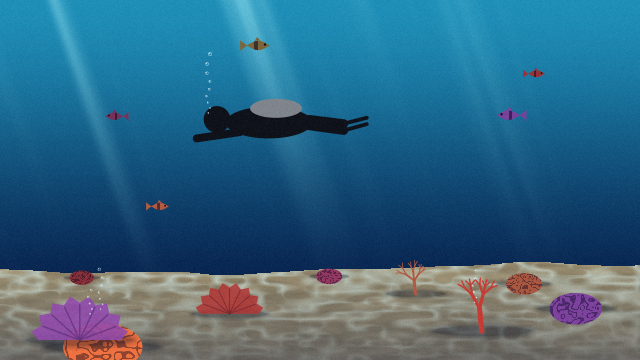</td>
</tr><tr><td valign="top">

*`a portrait of a woman with red hair and glasses`* (seed 6) — The portrait family: a stylised face in adult-head
proportions, the hair from the colour word, the glasses from theirs; never a likeness of anyone, and the picture's
notes say so.

</td><td valign="top">

*`a coral reef with five fish and a diver`* (seed 8) — The underwater family: light rays, caustics on the sand, coral,
bubbles, the five fish counted, a diver.

</td></tr></table>

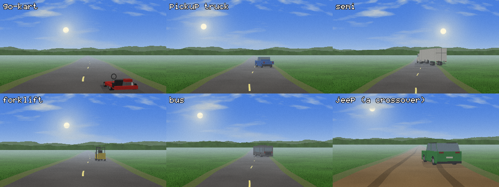

*`a red go-kart on a road`, `a blue pickup truck on a road`, `a white semi on a highway`, `a yellow forklift on a
road`, `a bus on a road`, `a green jeep on a dirt road`* — Vehicles from a figures table
(tools/image/things/vehicles.mjs: length, wheelbase, wheel sizes, cab and bed in metres, each with its source), seen
from behind and a little to the side on the road. The kart has no roll hoop because the sourced rental kart has none
(the ring over its body is the steering wheel); "jeep" draws the crossover the project holds.

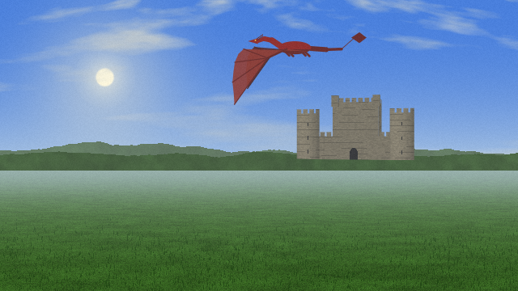

*`a dragon over a castle, a wizard on the drawbridge`* (seed 1) — What the tool does with words it does not
understand: it says so on stderr (below, captured from the real run: the wizard and the drawbridge), keeps the ignored
words in the PNG's tEXt chunk, and paints what it did understand (the dragon and the castle, counted as visible); with
`--strict` it writes nothing and exits 3 instead.

```
$ node tools/image.mjs "a dragon over a castle, a wizard on the drawbridge" --size 640x360 --seed 1
read as: day, grass, dragons 1, castle 1, hills (added to break the horizon)
not understood: wizard, drawbridge
visible: dragons 1/1, castle 1/1
```
<!-- /image-examples -->

### What the words can say

<!-- image-vocabulary: copied from the header of tools/image.mjs by `npm run image:examples` -->
What is understood: time (dawn/sunrise, morning, day, noon/midday, afternoon, golden hour, sunset/dusk/evening, blue
hour, night/midnight, moonlit, starlit), weather (clear/sunny, cloudy, overcast/grey, storm/thunderstorm/lightning,
fog/mist/haze, rain/drizzle/showers, wet, snowing/snowfall/blizzard/flurries, snow, snowy/snow-capped, frozen/icy/ice,
autumn/fall, spring, summer, winter), ground (grass/meadow/field, desert/sand/dunes, snow, pavement,
road/highway/lane/street/avenue, dirt/gravel, a track after race, dirt or train), water
(sea/ocean/lake/pond/bay/coast, river/stream/canal, harbour/port/marina, island/tropical/palm, beach/shore), things
(mountains/peaks/mountain range, hills, trees/forest/woods/pines/firs/oaks/palms,
house/cabin/cottage/barn/hut/farmhouse/village, buildings/city/town/skyline/cityscape/downtown/towers, vehicles from
their published or typical figures, seen from behind on a road or side-on: car/sedan/hatchback, kart/go-kart,
truck/pickup/lorry, semi/trailer/tractor-trailer/18-wheeler/rig, jeep/suv/4x4, van, bus/coach, taxi/yellow cab,
forklift, motorcycle/motorbike/bike, dirt bike, bicycle (and a bike when cycling or a bicycle is named),
atv/quad/four-wheeler, tractor/mower; boat/ship/sailboat/yacht/ferry/canoe, birds/gulls/crows,
flowers/poppies/tulips/daisies (dots over the grass, as a meadow or a field has), sun, moon and its phase, stars) with
counts ("three trees", "15 trees", "a hundred" is forty, "no trees"), colours and sizes before things ("red car",
"tiny cabin", "huge mountains"), places (near, far, left, right, centre), a style word (pixel art/8-bit,
poster/flat/cartoon, minimalist, sketch/pencil/line art, watercolour/painting, black and white/mono/greyscale, sepia,
vintage/retro/old photo) and a text to write ("the word HELLO", a quoted phrase, "saying ..."). "no" before a word
cancels it (no clouds, no trees). Words that name the picture itself (photo, scene, sky) are passed over. Families
beyond the landscape (a family picture has no ground and no horizon; stderr says which family painted and what it is):
space (mars, venus, jupiter, saturn, earth beside a space word, planet(s), orbit, moonscape, nebula, galaxy, space
alone or outer/deep space, cosmos, asteroid(s), moons: a planet from its known colours, not a photograph), abstract
(abstract, geometric/geometry, circle(s), triangle(s), square(s), shapes, pattern(s), gradient, mandala, stripes,
bauhaus, mondrian, op-art), portrait (portrait, face, selfie, headshot; woman/man/girl/boy alone; hair, eyes, beard,
glasses, smiling, blond/blonde, brunette, redhead as its details: a stylised face, not a likeness of anyone),
underwater (underwater, undersea, coral(s), reef(s), diving, diver(s), scuba, seabed, aquarium; fish/fishes with a
count). In a landscape: the sky's phenomena (rainbow(s) by day; aurora(s)/borealis/northern lights at night;
lightning/thunderbolt(s) under a storm) and the landforms (cactus/cacti/cactuses/saguaro(s) on sand,
palm-tree/palmtree/coconut-palm, volcano/volcanoes/volcanos with erupting/erupts/eruption(s) for lava,
waterfall(s)/cascade(s)). Structures in metres (houses by kind in three-quarter view, a city's skyline, lighthouse,
rocks, windmill, castle, church, bridge, tent, campfire, fence, streetlamp, telegraph pole, bench) and creatures (cat,
dog, horse, deer, cow, sheep, goat, wolf, elephant, camel, people and crowds; in the sky airplane, cessna, helicopter,
balloon, rocket, dragon, kite, birds by word, bats; whale, dolphin, shark, fish). Anything else in the words is
ignored, and --describe shows exactly what was kept: every ignored word, every silent change, and how much was
recognised.
<!-- /image-vocabulary -->

### The flags

`--out <file>` where to save (default `images/<date>-<slug>.png`); `--size WxH` (default 1280x720, each side 1 to
8192); `--seed <n>` the random choices (default: hashed from the words, so the same words give the same picture);
`--style <name>` one of pixel, poster, minimalist, sketch, watercolour, mono, sepia, vintage; `--text "..."` a caption
in the tool's 5x7 font; `--count <n>` n pictures from seeds seed, seed+1, ... seed+n-1 as `<out>-1.png` to
`<out>-n.png`; `--strip <n>` the same n seeds side by side in one wide picture; `--format png|ppm` (a P6 PPM carries
no text chunk); `--describe` print the reading as JSON and stop; `--strict` write nothing and exit 3 when a
noun-looking word is not understood; `--help` the whole header. `--` ends the options, so the words may begin with a
dash.

### Limits

The pictures are stylised, not photoreal: every thing is drawn from its published or typical figures in metres through
a camera (a kart's wheelbase, a lane's width, a pine's height), and since a real product's exact surface is its
maker's CAD and is not public (see CLAUDE.md, "What can honestly be promised"), a kart here is the shape of its
figures, not a likeness of a make, and a portrait is a stylised face, never a likeness of anyone. What the tool does
not know it says, on stderr and in the file, and `--strict` makes it refuse rather than paint around the gap.

The longer read, for anyone extending it, is [docs/IMAGE-TOOL.md](docs/IMAGE-TOOL.md): the pipeline, the module map,
how a thing, a family or a style is registered, the world under the paint, the honesty contract, the tests, and the
decisions made during the build with their reasons. `npm run image:examples` regenerates this gallery from one table,
and `npm run image:examples -- --check` proves the committed pictures are what the tool paints today.
